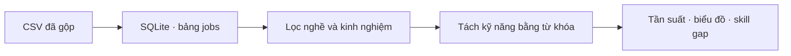
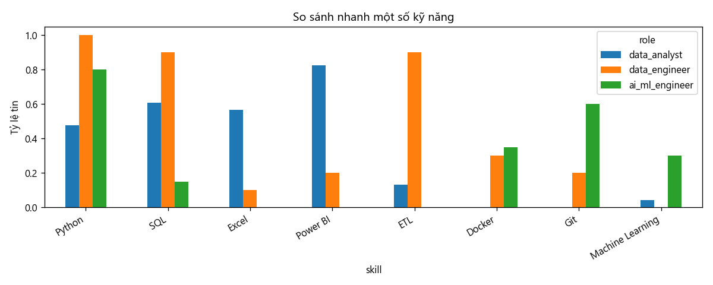

# SkillMap

Phân tích nhu cầu kỹ năng **Data Analyst**, **Data Engineer** và **AI/ML Engineer** từ tin tuyển dụng TopCV tại Việt Nam, phục vụ môn ADY201m.

SkillMap lấy các tin đã thu thập, đưa vào SQLite, lọc phần phù hợp với người mới vào nghề, rồi đếm kỹ năng được nhắc trong mô tả công việc. Từ đó có thể đối chiếu skill gap: kỹ năng thị trường hay yêu cầu nhưng chưa có trong danh sách của người học.



## Kết quả trên mẫu phân tích

Nguồn là 172 tin TopCV thu ngày 11/10/2026. Sau khi lọc còn **53 tin**: Data Analyst 23, Data Engineer 10, AI/ML Engineer 20.

| Nghề | Kỹ năng được nhắc nhiều nhất |
|---|---|
| Data Analyst | Power BI 19/23 · SQL 14/23 · Excel 13/23 · Python 11/23 |
| Data Engineer | Python 10/10 · ETL 9/10 · SQL 9/10 · Spark 7/10 |
| AI/ML Engineer | Python 16/20 · Git 12/20 · RAG 9/20 · LLM, PyTorch, Computer Vision 8/20 |

Ví dụ skill gap: người đang có Python, SQL và Excel, nhắm vị trí Data Analyst, thì Power BI là kỹ năng thiếu được nhắc nhiều nhất (19/23 tin), tiếp theo là Data Warehouse và Tableau (8/23).



Biểu đồ khác nằm trong `outputs/`: số tin theo nghề, top kỹ năng từng nghề, và địa điểm. Mẫu tập trung ở Hà Nội (37), Hồ Chí Minh (10) và Đà Nẵng (6).

## Dữ liệu

Notebook không đọc CSV. Dữ liệu chạy là SQLite.

| File | Vai trò |
|---|---|
| `topcv_skillmap.db` | Database notebook đang mở. Bảng `jobs`, khóa chính `source_job_id`, 172 dòng. |
| `topcv_skillmap.sql` | Bản text cùng nội dung: `CREATE TABLE` và `INSERT`. |
| `topcv-skillmap-processed.csv` | Bản CSV đã gộp, dùng để tạo database. |

Hai file crawl riêng cho Data Analyst và cho Data Engineer / AI-ML được giữ ở máy local, không có trên repo. Bảng `jobs` đã gồm cả hai nguồn đó.

Các cột chính: tiêu đề, công ty, địa điểm, kinh nghiệm, lương, mô tả, yêu cầu ứng viên, nhóm nghề, `role`, `scope_status`. Phần mô tả là cụm từ đã trích, không phải toàn văn trang tuyển dụng.

## Cách chạy

Cần Python 3, cùng `pandas` và `matplotlib`. Đặt `topcv_skillmap.db` cùng thư mục với notebook.

```bash
pip install pandas matplotlib
```

Mở `SkillMap_Kaggle.ipynb` và chạy lần lượt từ trên xuống. Notebook sẽ:

1. Kết nối SQLite và đếm tin theo nghề, ô trống, mã tin trùng.
2. Giữ ba nghề mục tiêu, kinh nghiệm từ 0 đến 2 năm, việc tại Việt Nam.
3. Bỏ tiêu đề Senior, Lead, Manager, Middle, All level, và một số tin lệch nghề.
4. Tách kỹ năng bằng từ điển từ khóa, vẽ biểu đồ, in skill gap mẫu.
5. Ghi `outputs/filtered_jobs.csv`, `outputs/job_skills.csv`, `outputs/skill_frequency.csv`.

Muốn đổi ví dụ skill gap, sửa `owned_skills` và `target_role` ở ô cuối rồi chạy lại ô đó.

Nếu cần tạo lại database từ file SQL:

```bash
sqlite3 topcv_skillmap.db < topcv_skillmap.sql
```

## Cấu trúc

```text
SkillMap_Kaggle.ipynb          phân tích
topcv_skillmap.db              SQLite
topcv_skillmap.sql             dump SQL
topcv-skillmap-processed.csv   CSV đã gộp
outputs/                       biểu đồ và bảng kết quả
BÁO CÁO DỰ ÁN DATA ANALYTICS.docx
```

## Phạm vi cần nhớ khi dùng số liệu

- Đây là một lát cắt TopCV ngày 11/10/2026, không đại diện toàn thị trường.
- Tỷ lệ là số tin có nhắc kỹ năng chia cho số tin của nghề trong mẫu 53 tin. Một tin nhắc nhiều lần vẫn tính một. Không suy ra xác suất được tuyển.
- Kinh nghiệm lấy từ cột `experience_raw`. «2–3 năm» lấy mốc cao hơn nên không vào mẫu. Tin ghi «2 năm» được giữ.
- Từ khóa có thể sót hoặc nhận nhầm. Chưa có nhãn tay, nên notebook không báo accuracy.
- Data Engineer trong mẫu chỉ có 10 tin. Tỷ lệ 100% ở nhóm này không mang cùng ý nghĩa với một mẫu lớn.
